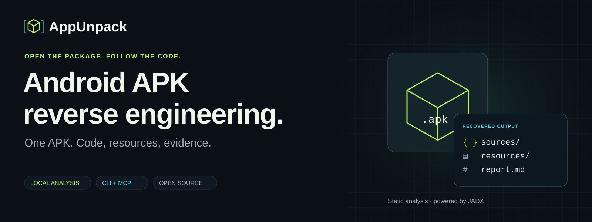
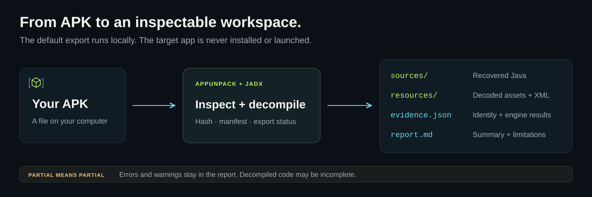
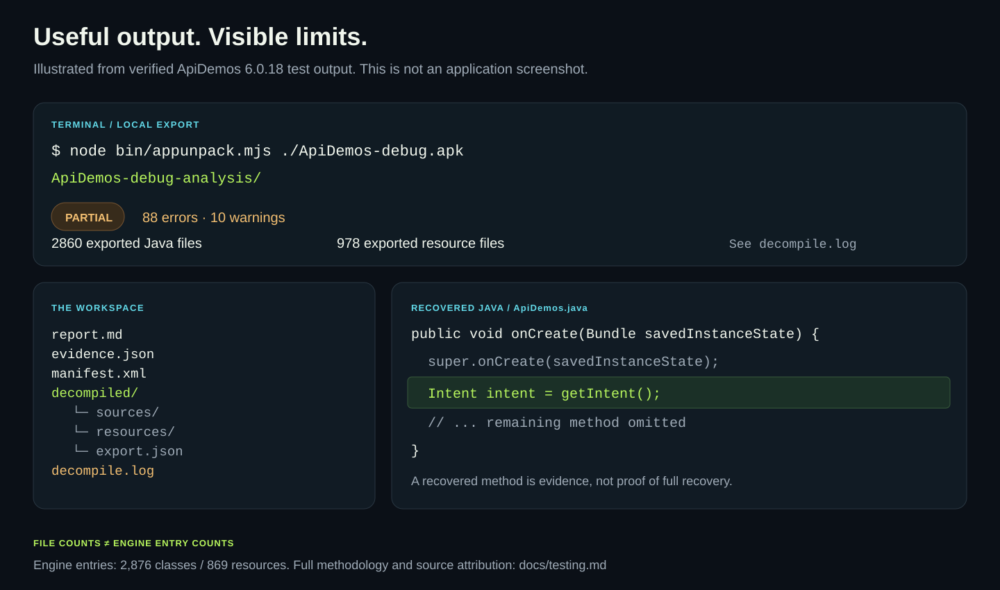

# AppUnpack — Android APK reverse engineering

**Give it an APK. Get decompiled Java, decoded resources and a local analysis report.**

[](https://github.com/samalyxx/appunpack/actions/workflows/ci.yml)
[](https://github.com/samalyxx/appunpack/releases/tag/v0.2.1)
[](https://nodejs.org/)
[](LICENSE)

[Website](https://samalyxx.github.io/appunpack/) · [Quick start](#quick-start) · [What you get](#what-you-get) · [AI agents](#connect-your-ai-agent) · [FAQ](#faq) · [Documentation](#documentation) · [Releases](https://github.com/samalyxx/appunpack/releases)



[▶ Watch the 24-second real APK demo](https://github.com/samalyxx/appunpack/releases/download/v0.2.1/AppUnpack-24s-features-demo.mp4)

Real NetGuard 2.337 analysis: manifest, permissions, resources and reconstructed Java. Edited for pacing; recovery is partial. Feature cards summarize code navigation, CLI/MCP and evidence reports.

Music: “Brain Dance” by Kevin MacLeod ([incompetech.com](https://incompetech.com/music/royalty-free/index.html?isrc=USUAN2300006)), [CC BY 4.0](https://creativecommons.org/licenses/by/4.0/). Edited excerpt, loudness adjusted, fades added.

AppUnpack is a local Android APK decompiler and analysis CLI powered by [JADX](https://github.com/skylot/jadx) through [jadx-headless-mcp](https://github.com/1013503897/jadx-headless-mcp). Analyze a file directly, inspect specific classes and methods, or connect an AI coding agent through MCP. A separate Python command inventories iOS IPA metadata.

## Quick start

Install **Git, Node.js 24.11 or newer, npm and a Java 17 or newer JDK**. Full APK export needs the JDK compiler modules. You do not need an Android device or an AI account.

```sh
git clone https://github.com/samalyxx/appunpack.git
cd appunpack
npm ci
node bin/appunpack.mjs install-tools
node bin/appunpack.mjs doctor
```

Then give it an actual APK file. On Windows:

```powershell
.\appunpack.ps1 'C:\Apps\Example.apk'
```

Or use Node directly on any supported host:

```sh
node bin/appunpack.mjs /path/to/Example.apk
```

AppUnpack creates a new `Example-analysis` directory beside the input APK and refuses to overwrite an existing output directory. Open `report.md`, then browse the recovered files. To choose a destination:

```sh
node bin/appunpack.mjs analyze /path/to/Example.apk --output ./reports/example
```

You supply the APK; a name or Play Store link is not an APK. The engine download happens during setup. Analysis runs on your computer. See [installation and Windows setup](docs/installation.md) for runtime selection and launcher troubleshooting.

## What you get



| Output | What to open it for |
| --- | --- |
| `decompiled/sources/` | Recovered Java classes and methods |
| `decompiled/resources/` | Decoded resources, including layouts and strings when available |
| `manifest.xml` | The manifest XML returned by the engine |
| `report.md` | Package summary, export status and limitations |
| `evidence.json` | Input identity and collected engine responses |
| `decompiled/export.json` | Export counts, errors, warnings and completion status |
| `decompile.log` | Diagnostics to investigate incomplete output |

**Recovered code is a derived view.** It is not the original Java/Kotlin project, a guaranteed buildable app or the application's backend. Obfuscation and decompilation errors can leave gaps even when many useful files are exported.

## Scope

| Target or workflow | Current support |
| --- | --- |
| Android `.apk` | Decompiled Java, decoded resources, manifest and evidence report |
| Class and method investigation | Class search, summaries, source, method bodies and cross-references |
| AI coding agents | Local Android MCP server and an APK investigation skill |
| iOS `.ipa` | Static archive and bundle metadata inventory with Python |
| Split APK sets | Combined JADX analysis of a compatible base/split directory or unambiguous `.apks`/`.xapk`; per-part resources retained |
| Apktool | Optional resource decoding and smali disassembly |
| Android native `.so` libraries | Optional Ghidra pseudocode/function reports; direct ELF or a selected APK member |
| Android devices | ADB device/package listing, base/split pulling and bounded logcat |
| Running processes | Optional Frida process listing and explicit PID/script capture |
| AAB variants, rebuilding and signing | No installable APK merging, AAB generation, rebuilding or signing |
| iOS executables | No iOS executable decompilation workflow |

Static references do not prove that a call occurs at runtime. Reports do not verify APK/IPA signatures or certify that an app is safe.

## Extended Android workflows

These commands use separately installed tools. The basic APK command stays static and needs no device. See [extended setup and commands](docs/android-workflows.md).

```sh
node bin/appunpack.mjs splits ./apk-set --output ./reports/splits
node bin/appunpack.mjs decode ./Example.apk --output ./reports/apktool
node bin/appunpack.mjs native-libs ./Example.apk
node bin/appunpack.mjs native ./Example.apk --library lib/arm64-v8a/libexample.so --output ./reports/native
node bin/appunpack.mjs devices
node bin/appunpack.mjs pull com.example.app --device emulator-5554 --output ./reports/pulled
node bin/appunpack.mjs logcat --device emulator-5554 --seconds 10 --output ./reports/logs
node bin/appunpack.mjs frida-ps --device DEVICE_ID
node bin/appunpack.mjs trace 1234 ./observe.js --device DEVICE_ID --seconds 10 --output ./reports/trace
```

Split analysis combines the supplied APKs for investigation and saves per-part identities/resources; it does not create an installable merged APK. Runtime commands select an existing device/process explicitly. A Frida script executes inside that process and can change its behavior.

## Follow the code

```sh
node bin/appunpack.mjs classes ./Example.apk MainActivity
node bin/appunpack.mjs class ./Example.apk com.example.MainActivity
node bin/appunpack.mjs source ./Example.apk com.example.MainActivity
node bin/appunpack.mjs method ./Example.apk com.example.MainActivity onCreate
node bin/appunpack.mjs references ./Example.apk com.example.MainActivity --method-name onCreate
node bin/appunpack.mjs resources ./Example.apk --query title
```

These commands return JSON. Use the class summary to select an overloaded method, then pass its index with `--overload-index`. See the [command reference](docs/usage.md).

## Connect your AI agent

```sh
node bin/appunpack.mjs mcp-config
```

Review the printed JSON and add it to your client's MCP settings. The server starts the Android engine directly over local stdio. [Agent setup](docs/agents.md) covers configuration, and the [APK analysis skill](skills/apk-analysis/SKILL.md) supplies a focused investigation workflow.

Example prompt:

> Inspect this APK's manifest, find the implementation behind its search screen, and trace the relevant classes, methods and callers. Include the APK hash, evidence and limitations. Separate observed facts from inferences.

The CLI does not require an AI account. If you connect a cloud AI client, the tool output it requests can be sent to that provider under the client's own data policy.

## Checked against real APKs



Three public APK fixtures were processed locally. All produced source, resources and reports; all reported a **partial** export. One recovered sieve algorithm was also compared against its original source and an independent check for six inputs.

Additional launch checks analyzed the official NetGuard 2.337 and Mullvad 2026.12 APKs, a Jellyfin 2.7.3 release bundle's base/ABI/density splits, and Android Frida attachment on an isolated API 36 emulator. The split APKs also passed an install/pull/hash/analysis round trip. Production Java exports remained partial; these checks establish useful output, not complete reconstruction.

The [verification record](docs/testing.md) includes fixture identities, hashes, error counts, test coverage and what was not checked. GitHub Actions runs unit/parser checks on Windows and Ubuntu and a separate real JADX integration workflow on Ubuntu. CI does not install or launch target Android apps.

## Initial iOS support

Install Python 3.10 or newer, then:

```sh
node bin/appunpack.mjs ipa ./Example.ipa --output ./reports/ios-example
```

This inventories the IPA archive and readable bundle metadata. Executable decompilation, FairPlay decryption and iOS runtime analysis are outside its scope. See [IPA usage](docs/usage.md#inspect-an-ipa).

## FAQ

<details>
<summary><strong>Does AppUnpack upload my APK?</strong></summary>

The built-in CLI processes the target locally. Setup downloads the engine and npm dependencies. A connected cloud AI client can send requested tool results to its provider; review that client's settings before connecting sensitive targets.

</details>

<details>
<summary><strong>Will it recover the exact original app?</strong></summary>

No. JADX reconstructs Java from compiled Android bytecode. Original Kotlin, comments, meaningful obfuscated names, build configuration, missing split modules and server-side code cannot be assumed recoverable. Native libraries require a separate investigation. Exported files may need manual interpretation and correction.

</details>

<details>
<summary><strong>What does a partial export mean?</strong></summary>

The engine reported errors or warnings while exporting. Useful files may still exist. Read `decompiled/export.json` and `decompile.log`, and check the specific method or resource you need. A large file count is not evidence that every method was recovered correctly.

</details>

<details>
<summary><strong>Why analyze an Android app on a computer?</strong></summary>

The Java engine benefits from desktop memory, an isolated workspace and code navigation tools. Static analysis does not require installing or launching the APK. Use a test device or emulator separately when a question requires observed runtime behavior.

</details>

<details>
<summary><strong>What do I need installed?</strong></summary>

Node.js 24.11 or newer, npm, Git and a Java 17 or newer JDK for full APK export. Python 3.10 or newer is needed for IPA, split preparation, APK preflight and native-library extraction; the basic JADX workflow does not need it. The setup command downloads and verifies the pinned JADX headless engine. GitHub release archives include source, not these runtimes or the engine JAR.

</details>

<details>
<summary><strong>Can I install it with npx?</strong></summary>

The current installation method is a GitHub source checkout or release archive followed by `npm ci`. There is no published AppUnpack npm release. You can run `npm link` from an installed checkout if you want an `appunpack` command on your PATH.

</details>

## Documentation

- [Installation](docs/installation.md): requirements, engine verification and platform setup.
- [Commands and outputs](docs/usage.md): APK and IPA workflows, flags and report contracts.
- [AI agent setup](docs/agents.md): local MCP configuration and investigation prompts.
- [Extended Android workflows](docs/android-workflows.md): split sets, Apktool, Ghidra, ADB and Frida.
- [Architecture](docs/architecture.md): how the CLI, engine and reports fit together.
- [Mobile reverse-engineering research](docs/mobile-tooling-research.md): Android and iOS tool comparisons.
- [Verification](docs/testing.md): reproducible checks, real APK results and limits.
- [Website and search visibility](docs/seo.md): public metadata and Google Search Console steps.
- [Changelog](CHANGELOG.md) and [GitHub releases](https://github.com/samalyxx/appunpack/releases).

## Contributing and responsible use

Report reproducible bugs through [GitHub issues](https://github.com/samalyxx/appunpack/issues). Include the command, runtime versions and sanitized diagnostics; keep private APKs and secrets out of public reports. See [contributing](CONTRIBUTING.md) and [security guidance](SECURITY.md).

Analyze software you own or are authorized to examine. Unfamiliar target files are parsed by Java with your user permissions; use an isolated environment.

## License

AppUnpack's code is [MIT licensed](LICENSE). JADX, jadx-headless-mcp, the MCP SDK and other dependencies retain their own licenses and notices. See [third-party notices](THIRD_PARTY_NOTICES.md). Integration names identify those projects and do not imply endorsement.
